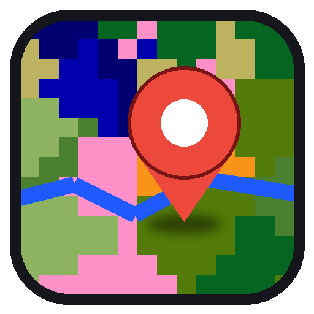
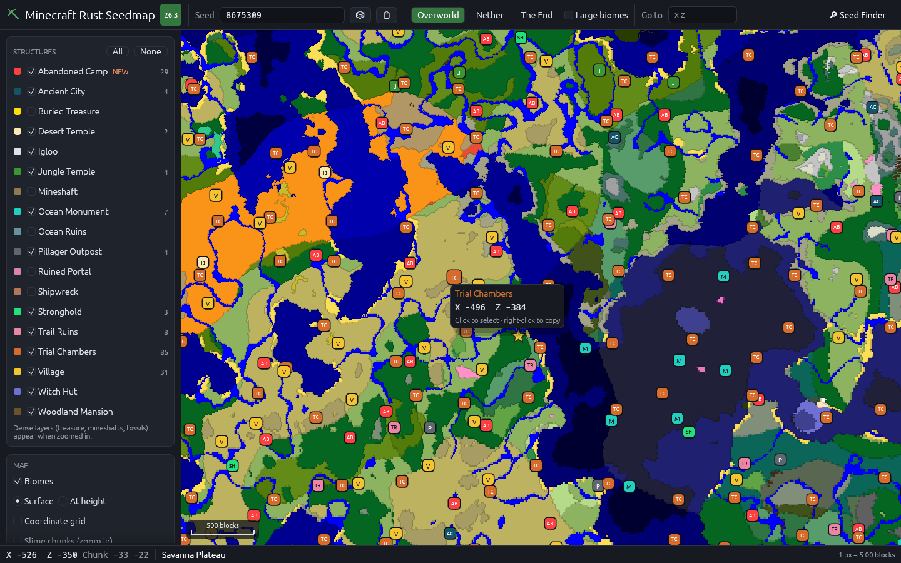
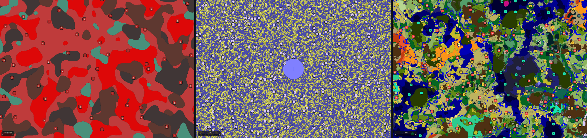
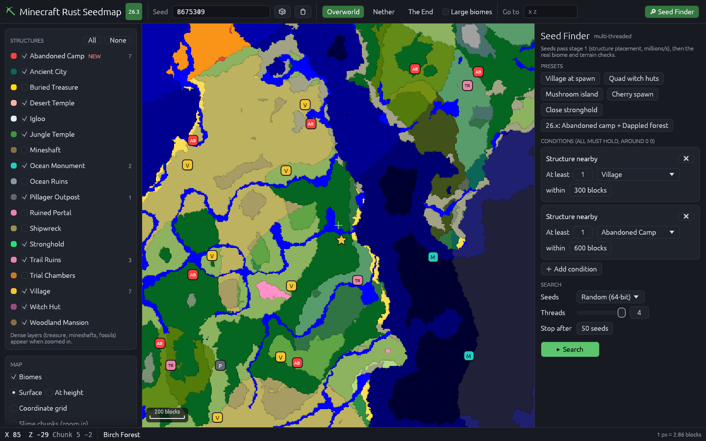

<div align="center">



# Minecraft Rust Seedmap

**A fast seed map and structure finder for [Minecraft Rust](https://github.com/elloexe/minecraft-rust) 26.3**,
the Rust rewrite of Minecraft: Java Edition. Think Chunkbase, but for 26.3, built on the game's own world generator
and with a multi-threaded seed finder.

[**⬇ Download for Windows**](https://github.com/elloexe/minecraftrust-seedmap/releases/latest) ·
[Features](#features) · [Accuracy](#accuracy) · [Seed finder](#seed-finder) · [Build from source](#build-from-source)



</div>

## Why

Seed maps like Chunkbase don't support Minecraft Rust or the 26.x worldgen: they're missing the
**Abandoned Camp** structure and the **Dappled Forest** and **Sulfur Caves** biomes, and they don't
know the new spawn search. This app computes all of it with the same code Minecraft Rust uses to generate the world.

Minecraft Rust matches vanilla Java 26.3 down to the order of random calls, so the maps also match **vanilla Java 26.3** worlds.

## Download

1. Open the [latest release](https://github.com/elloexe/minecraftrust-seedmap/releases/latest).
2. Download `minecraftrust-seedmap-windows-x64.exe`.
3. Run it. It's a single file with nothing to install, and it works offline.

> Windows 10 or 11 (64-bit). The executable isn't code-signed, so SmartScreen may show
> "Windows protected your PC". Choose **More info → Run anyway**.
> A Linux build is attached to each release as well.

## Features

**Map**
- Biome map for the **Overworld, Nether and End**, plus **Large Biomes**
- **Surface view** (each column at its own surface height, which is what you see in-game) or any
  **Y level**, so you can find lush caves, deep dark and sulfur caves underground
- Smooth pan and zoom from 8 px per block out to 512 blocks per pixel. Tiles render on every CPU core,
  with a coarse preview first and full detail after.
- Highlight one biome to see where it occurs, with a clickable biome legend
- Coordinate grid, slime chunks, scale bar, and the block, chunk and biome under the cursor
- Text seeds are hashed the same way the game does (`String.hashCode`)
- Settings, seed and view are remembered between runs

**Structures**: all 21 structure sets of 26.3

| Overworld | | | Nether / End |
|---|---|---|---|
| Village (5 variants) | Desert Temple | Ocean Monument | Fortress / Bastion |
| **Abandoned Camp** ✦ new in 26.x | Jungle Temple | Ocean Ruins | Nether Fossil |
| Pillager Outpost | Witch Hut | Shipwreck | Ruined Portal (Nether) |
| Woodland Mansion | Igloo | Buried Treasure | End City |
| Ancient City | Trial Chambers | Mineshaft | |
| Trail Ruins | Ruined Portal (7 kinds) | **Stronghold** (all 128) | |

- **World spawn**: the game's own `NoiseSpawnFinder`, exact to the block
- **Strongholds**: all 128 ring positions, including the game's biome search
- Click a structure to select it, and right-click anywhere to copy coordinates or a `/tp` command
- "Placement-only candidates" mode shows the chunks a structure set picks even when its biome or terrain rule then rejects them



## Seed finder



Open **🔎 Seed Finder** in the top-right corner. Add conditions (they all must hold, measured around 0 0) and press **Search**:

| Condition | Example |
|---|---|
| Structure nearby | at least 2 villages within 300 blocks |
| Structure cluster | 4 witch huts within 200 blocks of each other (quad huts), within 3000 blocks |
| Biome nearby | mushroom fields within 800 blocks |
| Spawn biome | spawn in a cherry grove |
| Stronghold nearby | a stronghold within 900 blocks |

There are one-click presets, a choice of seed source (random 64-bit, random 32-bit "text" seeds, or counting up from a
seed), a thread count, and live stats. Click **Open** on a result to load it on the map.

### How it gets to millions of seeds per second

Search runs in stages and does the cheapest work first:

1. **Placement (stage 1).** The region RNG (`java.util.Random`) is inlined. That's about 200 million region tests per second per
   thread, needs no world, and rejects nearly every seed. It's checked against Minecraft Rust's own placement on random inputs.
2. **World checks (stage 2).** Only seeds that pass stage 1 get a compiled world (about 0.6 ms). Then the structures' real biome and terrain rules run,
   first with fast surface estimates, then confirmed with the exact terrain density.
3. **Biomes, spawn and strongholds.** These run last.

So throughput depends on how picky your structure conditions are. When they are picky the finder runs at millions of seeds per second,
and a biome-only search runs at thousands. The panel shows both how many seeds were checked and how many passed stage 1.

## Accuracy

Everything was checked against the **real 26.3 game classes**. [`tools/oracle/SeedmapOracle.java`](tools/oracle/SeedmapOracle.java)
runs vanilla's own `Structure.generate`, `NoiseSpawnFinder`, stronghold ring search and biome source on the official server jar.
[`crates/core/examples/verify.rs`](crates/core/examples/verify.rs) then compares the output with this app. The checks covered 4 overworld seeds, plus the
Nether and End of one seed, over 200–240 chunk squares:

| What | Matches vanilla |
|---|---|
| Noise biomes (Overworld, Nether, End, 3 heights) | **46,818 / 46,818** |
| World spawn | **4 / 4** (exact block) |
| Stronghold positions | **512 / 512** |
| Structure placement (candidate chunks, all sets) | **exact** |
| Structure starts found | **3,031 / 3,036** (99.8%), 6 false positives |

The structure check found these exactly: mineshafts (860), nether fossils (1,131), ocean ruins (218), shipwrecks (161),
trial chambers (183), buried treasure (62), abandoned camps (42), monuments (32), end cities (14) and every temple, igloo and
witch hut sampled. The few misses are jigsaw structures (villages, outposts, ancient cities). Vanilla checks those at the centre of a
randomly chosen start piece, and this app checks them at the start chunk's corner, a few blocks away. That only matters right on a biome border.

## Using it

| Action | How |
|---|---|
| Pan | drag |
| Zoom | mouse wheel or pinch. Double-click zooms in. |
| Select a structure | click its marker |
| Copy coordinates or `/tp` | right-click |
| Jump somewhere | type `x z` in **Go to**, then press Enter |

Command-line options are useful for shortcuts:

```text
minecraftrust-seedmap.exe --seed 8675309 --dimension nether --at 120 -400 --zoom 0.5 --finder
```

Other options are `--height <y>` (biomes at a fixed Y) and `--layer <structure set>` (turn a layer on, for example `trial_chambers`).

## How it works

```text
┌────────────────────────── minecraftrust-seedmap.exe ──────────────────────────┐
│ app (egui/wgpu)    map tiles · markers · seed finder UI · background workers   │
├────────────────────────────────────────────────────────────────────────────────┤
│ seedmap-core       biome grids · structure viability · spawn · strongholds ·   │
│                    staged multi-threaded seed search                           │
├────────────────────────────────────────────────────────────────────────────────┤
│ claudium-world /   Minecraft Rust's own world generator (git dependency,       │
│ claudium-core      pinned): density-function compiler, climate index,          │
│                    End source, structure registry, Java RNGs, spawn finder     │
├────────────────────────────────────────────────────────────────────────────────┤
│ 26.3 worldgen data noise settings, density functions, noises, biome tags,      │
│ (embedded, 47 KiB) structures and structure sets, multi-noise parameter tables │
└────────────────────────────────────────────────────────────────────────────────┘
```

- **Biomes** use Minecraft Rust's density functions compiled for the seed. The five height-independent climate fields
  are sampled in bulk across a tile, and the climate parameter search runs on the game's own R-tree index.
- **Structures**: placement goes through Minecraft Rust's `StructureRegistry`, which covers random spread, frequency reduction,
  exclusion zones and concentric rings. Each candidate then picks its variant with vanilla's weighted draw and is checked with
  that structure's own rule: the biome at the start position, temple footprint heights, the monument's 29-block ocean ring, the
  mansion and End city y ≥ 60 rule, the nether fossil floor search, and Minecraft Rust's own mineshaft layout.
- **Data**: the worldgen data is extracted at build time from the official 26.3 server jar downloaded from Mojang,
  the same way Minecraft Rust prepares its own. It's never committed to this repository.

## Build from source

You need Rust 1.95 or newer, **Java 25** (the data generator writes the multi-noise tables), and `curl`.

```bash
cargo xtask extract
```

That downloads the 26.3 server jar into `.cache/` and writes `data/worldgen-26.3.bin`. Then build and run:

```bash
cargo run --release -p minecraftrust-seedmap
```

The executable is written to `target/release/minecraftrust-seedmap(.exe)`. The engine has its own tests and
benchmarks:

```bash
cargo test --release -p seedmap-core
cargo run --release -p seedmap-core --example bench
cargo run --release -p seedmap-core --example search_bench
```

### Checking against vanilla yourself

```bash
# classpath: the 26.3 server jar's bundled game jar and libraries (unzip META-INF/ from it)
javac -cp "$CP" -d out tools/oracle/SeedmapOracle.java
java -cp "$CP:out" SeedmapOracle oracle.txt 8675309 overworld 120
cargo run --release -p seedmap-core --example verify -- oracle.txt 8675309 overworld 120
```

## Limitations

- Only 26.3 is supported. Older versions generate different worlds.
- Jigsaw structures are checked at their start chunk's corner (see [Accuracy](#accuracy)).
- Ruined portals and other template-based structures are checked at the chunk centre. Placement and biomes are exact,
  and a handful of variants differ near biome borders.
- Structure markers show where vanilla checks the biome, which is close to the structure but not its exact bounding box.

## Credits and licence

- World generation by **[Minecraft Rust](https://github.com/elloexe/minecraft-rust)** (Claudium) under the MIT licence. This app
  links its `claudium-world` and `claudium-core` crates.
- Released under the [MIT licence](LICENSE).
- Not an official Minecraft product. Not approved by or associated with Mojang or Microsoft. "Minecraft" is a trademark of Mojang AB.
