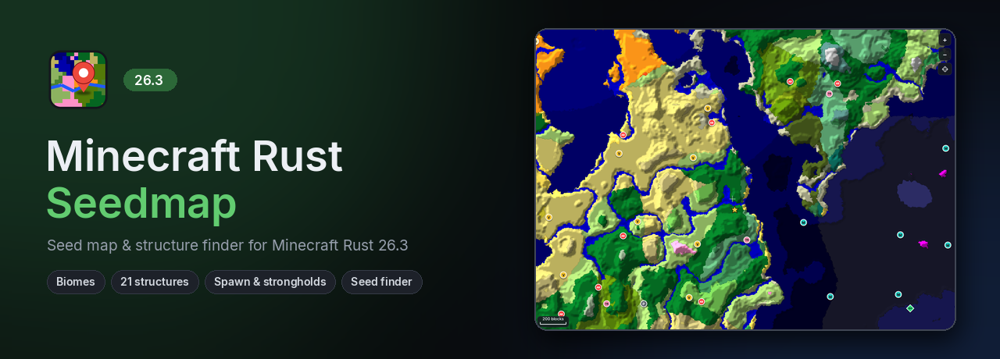
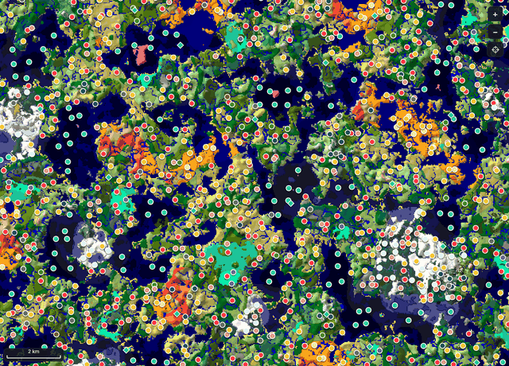

<div align="center">



<br>

[](https://github.com/elloexe/minecraftrust-seedmap/releases/latest)
[](https://github.com/elloexe/minecraftrust-seedmap/releases)
[](https://github.com/elloexe/minecraftrust-seedmap/actions/workflows/ci.yml)
[](LICENSE)

### A Chunkbase-style seed map and seed finder for [Minecraft Rust](https://github.com/elloexe/minecraft-rust) 26.3, running on the game's own world generator.

<br>

<a href="https://github.com/elloexe/minecraftrust-seedmap/releases/latest/download/minecraftrust-seedmap-windows-x64.exe"></a>

<sub>Windows 10/11 · single 13 MB file · no install · works offline · <a href="https://github.com/elloexe/minecraftrust-seedmap/releases/latest">Linux build too</a></sub>

<br><br>



</div>

<br>

## ✨ Highlights

<table>
<tr>
<td width="50%" valign="top">

### 🗺️ A real map, not colour blobs
Every biome is shaded by the terrain underneath it, so mountains, valleys and ocean
depth are visible at a glance. Pan and zoom smoothly from whole regions down to single chunks.
Tiles render on all your CPU cores.

</td>
<td width="50%" valign="top">

### 🏰 Every structure in 26.3
All **21 structure sets**, including the new **Abandoned Camp**, all **128 strongholds**
and the **exact world spawn**. Click a marker for coordinates, and right-click to copy a `/tp` command.

</td>
</tr>
<tr>
<td valign="top">

### 🔎 Seed finder
Describe the world you want: "2 villages and 2 abandoned camps near spawn", "quad witch huts"
or "spawn in a cherry grove". The finder searches on every core, and its first stage runs at
about **200 million checks per second per core**.

</td>
<td valign="top">

### 🎯 Verified against vanilla
Checked against the **official 26.3 game code**: biomes 46,818 / 46,818,
spawn 4 / 4, strongholds 512 / 512, structures 99.8%. See [Accuracy](#-accuracy).

</td>
</tr>
</table>


## 🚀 Quick start

1. **[Download the .exe](https://github.com/elloexe/minecraftrust-seedmap/releases/latest/download/minecraftrust-seedmap-windows-x64.exe)** and run it.
   The file isn't code-signed yet, so if Windows SmartScreen appears, choose **More info → Run anyway**.
2. Type your seed in the box at the top left. Numbers and text both work, and text is hashed exactly like the game does it.
3. Pick a dimension (**Overworld / Nether / The End**) and turn structure layers on or off in the sidebar.

| | |
|---|---|
| **Pan** | drag the map |
| **Zoom** | mouse wheel, the **+ / −** buttons, or double-click |
| **Structure info** | hover a marker, and click it to select |
| **Copy coordinates or `/tp`** | right-click anywhere |
| **Jump to coordinates** | type `x z` in *Go to* and press Enter |
| **Find a biome** | *Highlight* in the sidebar, or click a biome in the legend |

## 🗺️ What's on the map

| Map | Structures | 26.x additions |
|---|---|---|
| Overworld, Nether, End | Villages (5 kinds), outposts, mansions | **Abandoned Camp** (18 variants) |
| Large Biomes worlds | Temples, igloos, witch huts | **Dappled Forest** biome |
| Surface or any Y level (cave biomes) | Monuments, ocean ruins, shipwrecks, buried treasure | **Sulfur Caves** biome |
| Terrain shading and ocean depth | Ancient cities, trial chambers, trail ruins | |
| Biome highlight and legend | Mineshafts, ruined portals (7 kinds) | |
| Slime chunks, coordinate grid | Strongholds (all 128) and world spawn | |
| | Fortresses, bastions, nether fossils, End cities | |


## 🔎 Seed finder


Open **🔎 Seed Finder** at the top right, add conditions (all of them must hold, measured around 0 0) and press **Search**.
The search shown above found 50 seeds with 2 villages within 250 blocks *and* 2 abandoned camps within 400 blocks in **0.5 seconds**.

| Condition | Example |
|---|---|
| **Structure nearby** | at least 2 villages within 300 blocks |
| **Structure cluster** | 4 witch huts within 200 blocks of each other (quad huts) |
| **Biome nearby** | mushroom fields within 800 blocks |
| **Spawn biome** | spawn in a cherry grove |
| **Stronghold nearby** | a stronghold within 1,600 blocks (the closest ones are always about 1,400+ out) |

One-click presets: *Village at spawn*, *Quad witch huts*, *Mushroom island*, *Cherry spawn*, *Close stronghold*, *Abandoned camp + Dappled forest*.
You can search random 64-bit seeds, 32-bit seeds (the kind text seeds produce), or count up from a seed of your choice. Click **Open** on a result to load it on the map.

<details>
<summary><b>How is it that fast?</b></summary>

<br>

The search does the cheapest work first and throws a seed away as soon as it fails:

1. **Placement.** Where a structure *can* go is pure random-number math. The app runs Java's `Random` inline, at
   about 200 million region checks per second per core, without generating any world. Nearly every seed stops here.
2. **World checks.** Survivors get a real world compiled for their seed (about 0.6 ms). Each structure then has to pass its actual
   biome and terrain rules, checked quickly first and then confirmed exactly.
3. **Biomes, spawn and strongholds.** These run last, and only on the few seeds still standing.

The stricter your structure conditions, the faster it goes. The panel shows how many seeds were checked and how many passed stage 1.

</details>

## 🎯 Accuracy

The real Minecraft 26.3 server classes are the reference. [`tools/oracle/SeedmapOracle.java`](tools/oracle/SeedmapOracle.java)
runs vanilla's own biome source, spawn finder, stronghold search and `Structure.generate`, and
[`verify.rs`](crates/core/examples/verify.rs) compares them with this app. The comparison covered 4 overworld seeds and a seed's Nether and End:

| | Matches vanilla 26.3 |
|---|---|
| 🌍 Biomes (Overworld, Nether, End; 3 heights) | **46,818 / 46,818** |
| ⭐ World spawn | **4 / 4**, exact to the block |
| 🏰 Stronghold positions | **512 / 512** |
| 📍 Structure placement | **exact**, every set |
| 🏘️ Structure starts | **3,031 / 3,036** (99.8%), 6 false positives |

Mineshafts (860), nether fossils (1,131), ocean ruins (218), trial chambers (183), shipwrecks (161), buried treasure (62),
abandoned camps (42), monuments (32) and End cities (14) matched exactly. The handful of misses are villages and outposts sitting right on a
biome border: the game checks the biome at a randomly built start piece a few blocks from the chunk corner the app checks.

The pinned ground truth runs as tests on every push ([`crates/core/tests/vanilla.rs`](crates/core/tests/vanilla.rs)).

## ❓ FAQ

<details>
<summary><b>Does it work for normal (vanilla) Minecraft Java 26.3?</b></summary>
<br>
Yes. Minecraft Rust reproduces vanilla 26.3 world generation down to the order of random calls, and the accuracy numbers above were measured against vanilla itself.
</details>

<details>
<summary><b>What about other versions?</b></summary>
<br>
Only 26.3. World generation changes between versions (26.x added the abandoned camps and the new biomes, for example).
</details>

<details>
<summary><b>Windows says it "protected your PC". Is it safe?</b></summary>
<br>
That warning appears for any program that isn't code-signed. The release is built in public by
<a href="https://github.com/elloexe/minecraftrust-seedmap/actions/workflows/release.yml">GitHub Actions</a> from this source code, and
<code>SHA256SUMS.txt</code> is attached to each release. Choose <b>More info → Run anyway</b>.
</details>

<details>
<summary><b>Does it need the internet or Minecraft installed?</b></summary>
<br>
No. All world generation data is inside the .exe. It remembers your seed, layers and view between runs.
</details>

<details>
<summary><b>Can I open it at a seed from a shortcut or script?</b></summary>
<br>

```text
minecraftrust-seedmap.exe --seed 8675309 --dimension nether --at 120 -400 --zoom 0.5 --finder
```

Other options: `--height <y>` (biomes at a fixed Y) and `--layer <name>` (turn a layer on, e.g. `trial_chambers`).
</details>

## 🛠️ How it works

```text
┌─────────────────────── minecraftrust-seedmap.exe ────────────────────────┐
│ app            egui + wgpu: tiled map, terrain shading, markers, finder  │
│ seedmap-core   biome grids · structure rules · spawn · strongholds ·     │
│                staged multi-threaded seed search                         │
│ claudium-*     Minecraft Rust's own world generator (pinned git dep):    │
│                density functions, climate index, structure registry      │
│ 26.3 data      worldgen data from Mojang's server jar, embedded (47 KiB) │
└──────────────────────────────────────────────────────────────────────────┘
```

- **Biomes** come from Minecraft Rust's density functions compiled for your seed and its climate index. Height-independent
  climate fields are sampled in bulk for a whole tile at once.
- **Structures** are placed by Minecraft Rust's `StructureRegistry`. Each candidate then goes through the same per-structure rules as the game: variant
  weights, the biome at the start position, temple footprints, the monument ocean ring, mansion and End city height limits, the nether fossil floor
  search, and the game's own mineshaft layout.
- **Terrain shading** uses the generator's preliminary surface height, smoothed and lit from the northwest.
- **Data**: no Mojang files are committed. The build downloads the official 26.3 server jar from Mojang and extracts what it needs.

## 🧑‍💻 Build from source

Requirements: [Rust](https://rustup.rs) 1.95+, **Java 25** (to run Mojang's data generator), and `curl`.

```bash
git clone https://github.com/elloexe/minecraftrust-seedmap
```

```bash
cd minecraftrust-seedmap
```

```bash
cargo xtask extract
```

```bash
cargo run --release -p minecraftrust-seedmap
```

`cargo xtask extract` downloads the 26.3 server jar into `.cache/` and writes `data/worldgen-26.3.bin`, which gets embedded into the app.

<details>
<summary><b>Tests, benchmarks, and checking against vanilla yourself</b></summary>

<br>

```bash
cargo test --release -p seedmap-core
```

```bash
cargo run --release -p seedmap-core --example bench
```

```bash
cargo run --release -p seedmap-core --example search_bench
```

To compare with vanilla, put the server jar's bundled game jar and libraries on the classpath (`$CP`), then:

```bash
javac -cp "$CP" -d out tools/oracle/SeedmapOracle.java
```

```bash
java -cp "$CP:out" SeedmapOracle oracle.txt 8675309 overworld 120
```

```bash
cargo run --release -p seedmap-core --example verify -- oracle.txt 8675309 overworld 120
```

</details>

## 🙏 Credits

- World generation by **[Minecraft Rust](https://github.com/elloexe/minecraft-rust)** (Claudium), MIT licence. See [NOTICE.md](NOTICE.md).
- UI font [Inter](https://rsms.me/inter/) by Rasmus Andersson, SIL Open Font Licence ([assets/fonts](assets/fonts/Inter-LICENSE.txt)).
- Built with [egui](https://github.com/emilk/egui) and [wgpu](https://wgpu.rs).
- Released under the [MIT licence](LICENSE).

<sub>Not an official Minecraft product. Not approved by or associated with Mojang or Microsoft. "Minecraft" is a trademark of Mojang AB.</sub>
